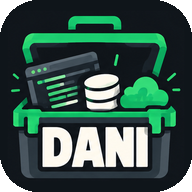
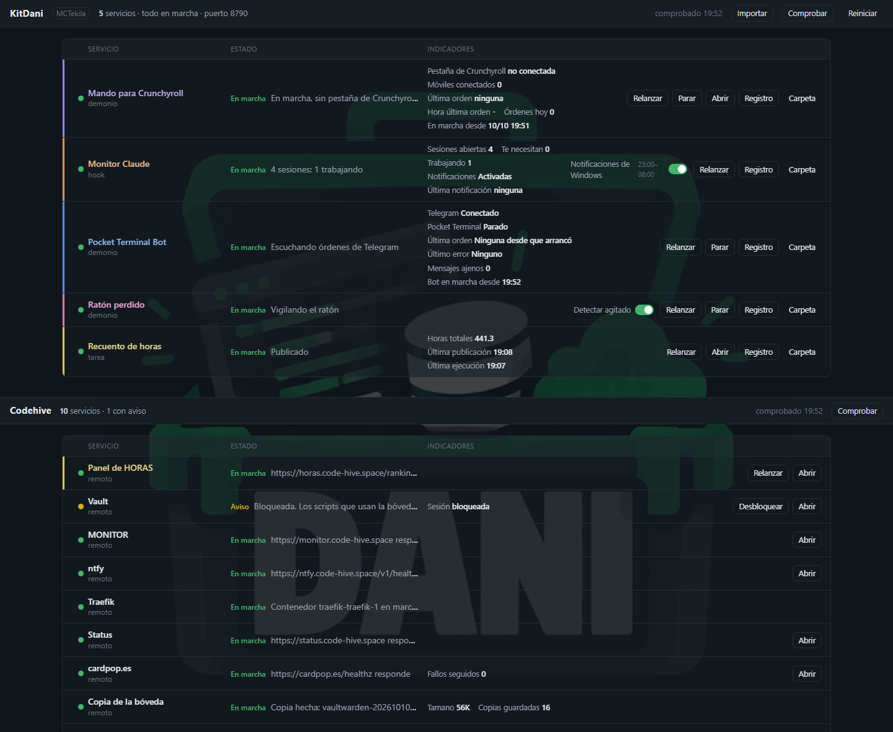
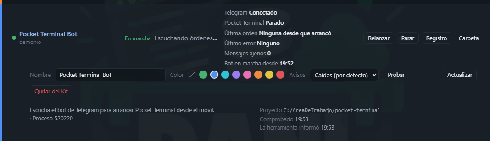
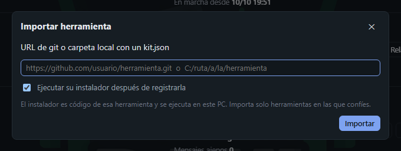

<div align="center">



# KitDani

Un panel para Windows que vigila tus propias herramientas: lo que arranca con el PC,<br>
las tareas programadas, los hooks y lo que corre en tu servidor. Todo en una tabla, con avisos al móvil.

[English](README.md) · **Español**

[](https://github.com/Dasge97/KitDani/commits/main)
[](#instalación)
[](https://nodejs.org)
[](package.json)
[](https://ntfy.sh)
[](LICENSE)
[](https://github.com/Dasge97/KitDani/commits/main)



[](#instalación)
&nbsp;
[](docs/kit-json.md)
&nbsp;
[](docs/como-funciona.md)

</div>

## Para qué sirve

Cuando empiezas a hacerte tus propias herramientas (un bot que arranca con el PC, un script que
publica algo cada dos horas, un servicio en tu servidor), acabas sin saber cuáles están en marcha,
cuáles han fallado esta noche y dónde está cada una. KitDani las reúne en una sola página, te deja
manejarlas desde ahí y te avisa al móvil cuando algo se cae.

## Qué hace

- **Una fila por herramienta**, con su estado, lo que está haciendo y los datos que ella misma quiera enseñar.
- **Botones** para arrancar, parar, abrir, ver su registro y abrir su carpeta.
- **Interruptores** para cambiar un ajuste de una herramienta, con horario opcional. Por ejemplo,
  silenciar unas notificaciones de 23:00 a 08:00.
- **Sección propia para cada servidor**, vigilada por HTTP y por SSH. Incluye las webs que vigila
  [Uptime Kuma](https://github.com/louislam/uptime-kuma), si lo usas.
- **Avisos al móvil** por [ntfy](https://ntfy.sh) cuando algo se cae y cuando vuelve. Eliges por
  herramienta si te avisa de todo, solo de caídas o de nada.
- **Un solo canal de avisos.** Tus herramientas avisan a través del Kit, sin tener cada una su token.
  En el servidor, con `kit-estado` y `kit-avisar`, que avisan aunque el PC esté apagado.
- **Importar herramientas.** Cualquier herramienta con un `kit.json` se añade pegando la URL de su
  repositorio. El Kit la clona, comprueba requisitos, la instala y la vigila.
- **Tu tabla.** Nombre, color y orden de cada fila se cambian desde la página.
- **Aplicación propia**, con su icono en la barra de tareas, separada de tu navegador.

<div align="center">
<table>
<tr>
<td align="center"><br><sub>Detalle de una herramienta</sub></td>
<td align="center"><br><sub>Importar desde una URL de git</sub></td>
</tr>
</table>
</div>

## Colores

| | Estado | Cuándo |
|:-:|---|---|
| 🟢 | En marcha | La comprobación y la propia herramienta dicen que va bien |
| 🟡 | Aviso | Algo raro que no es un fallo: sin noticias desde hace rato, o una web caída en el servidor |
| 🔴 | Error | La herramienta ha informado de un fallo, o su tarea programada falló |
| ⚫ | Parado | No está en marcha |
| ⚪ | Sin datos | Todavía no se ha podido comprobar |

## Instalación

Hace falta [Node.js](https://nodejs.org) 22 o superior, y [Git](https://git-scm.com) para importar desde una URL.

```powershell
git clone https://github.com/Dasge97/KitDani.git
cd KitDani
powershell -ExecutionPolicy Bypass -File .\instalar-arranque.ps1
```

El instalador registra la tarea programada `KitDani`, que arranca el panel al iniciar sesión y lo
relanza si se cae. Al terminar abre http://localhost:8790/.

**Icono en la barra de tareas.** En Chrome o Edge, pulsa el botón de instalar a la derecha de la barra
de direcciones ("Instalar KitDani"). Con la ventana abierta, clic derecho en su icono de la barra de
tareas → *Anclar a la barra de tareas*.

**Actualizar:** `git pull` en la carpeta del Kit y botón **Reiniciar** del panel.

## Uso

**Importar una herramienta.** Botón **Importar** y la URL de su repositorio, o la ruta de una
carpeta de tu PC. Para probar: `https://github.com/Dasge97/raton-perdido.git`.

**Ver y cambiar una herramienta.** Clic en su fila. En el detalle se cambia el nombre, el color y el
modo de avisos, se manda un aviso de prueba, y están **Actualizar** y **Quitar del Kit**.

**Reordenar.** Arrastra la fila desde el asa ⋮⋮ que aparece a su izquierda al pasar el ratón.

**Hacer importable tu herramienta.** Añade un `kit.json` en la raíz de su repositorio. El mínimo
son diez líneas. Formato y ejemplos en [docs/kit-json.md](docs/kit-json.md).

## Configuración

`config.local.json` se crea solo la primera vez. Es de cada PC y no va al repositorio.

```json
{
  "carpeta_herramientas": "C:/Users/tu-usuario/herramientas",
  "ntfy": { "url": "https://ntfy.sh", "tema": "mi-tema-privado" },
  "avisar_remotos": true
}
```

| Clave | Para qué |
|---|---|
| `carpeta_herramientas` | Dónde se clonan las herramientas importadas por URL. Por defecto, junto a la carpeta del Kit |
| `ntfy` | Servidor y tema de los avisos. Sin ellos no se avisa. Si tu servidor pide token, guárdalo en `%LOCALAPPDATA%\KitDani\ntfy-token` |
| `avisar_remotos` | Si tienes el Kit en varios PC, déjalo a `true` solo en uno, para no recibir dos veces los avisos del servidor |

Tras cambiarla, botón **Reiniciar**.

## En tu servidor

Lo que corre en un servidor Linux también informa al Kit y avisa al móvil, aunque el PC esté apagado.
La carpeta [`remoto/`](remoto) instala tres comandos:

| Comando | Para qué |
|---|---|
| `kit-estado <id> <ok/aviso/error/parado> "<mensaje>"` | Al terminar un script: deja su estado para el panel y avisa si falla y cuando vuelve |
| `kit-avisar <id> "<título>" "<texto>"` | Un aviso suelto |
| `kit-kuma` | Lee Uptime Kuma y avisa cuando una web cae o vuelve. Para cron |

Se necesita Python 3 en el servidor. Instalación:

```bash
scp remoto/kit.py remoto/instalar.sh servidor:/tmp/
ssh servidor 'bash /tmp/instalar.sh https://ntfy.example.com mi-tema'
ssh servidor 'umask 077; cat > ~/.config/kit/ntfy-token' < fichero-con-el-token
```

En el panel, cada script del servidor se registra como servicio `remoto` con `comprobar.host` y
`comprobar.estado_remoto` apuntando a `~/kit/estado/<id>.json` (ruta absoluta).
Más detalles en [Cómo funciona](docs/como-funciona.md#avisos-al-móvil).

## Preguntas frecuentes

<details>
<summary><b>¿Se puede abrir desde otro equipo o desde el móvil?</b></summary>

No. Solo escucha en `127.0.0.1`, porque sus botones ejecutan comandos en tu PC.
Al móvil solo llegan los avisos.
</details>

<details>
<summary><b>¿Es seguro importar una herramienta?</b></summary>

El instalador de una herramienta es código de esa herramienta y se ejecuta en tu PC.
Importa solo herramientas en las que confíes, o desmarca "Ejecutar su instalador" y revísalo antes.
</details>

<details>
<summary><b>¿Y si apago el PC?</b></summary>

El panel deja de comprobar, pero lo que corre en el servidor sigue avisando por su cuenta con
`kit-estado`. Al encender el PC ves en la sección del servidor qué pasó mientras tanto.
</details>

<details>
<summary><b>¿Lo puedo tener en varios PC?</b></summary>

Sí. El Kit es el mismo en todos y lo de cada PC queda fuera del repositorio. En cada PC lo instalas e
importas las herramientas que quieras tener en él.
</details>

<details>
<summary><b>¿Cómo lo desinstalo?</b></summary>

Ver [Cómo funciona → Desinstalar](docs/como-funciona.md#desinstalar).
</details>

## Licencia

[MIT](LICENSE).

---

<div align="center">

[Adaptar tu herramienta](docs/kit-json.md) · [Cómo funciona](docs/como-funciona.md) · [English](README.md)

</div>
